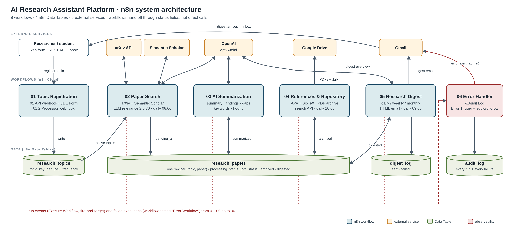

# AI Research Assistant Platform: n8n Capstone

**IIT Jammu AI/LLM Summer School 2026 · n8n Capstone Project · Assignment 8**
Domain: Research & Knowledge Management · Author: **Anshika Rana**

A modular n8n automation system that runs a researcher's literature workflow end to end:

> **Register a topic once** → papers are **collected** daily from arXiv and Semantic Scholar → an LLM keeps only **relevant** ones → each paper gets a **structured AI summary** and keywords → **APA / BibTeX references** and a **PDF archive** are built → a **searchable repository** answers queries → a personalised **research digest** is emailed at the chosen frequency. **Every run and every failure is audited.**



## At a glance

| | |
|---|---|
| Workflows | **8** (the brief asks for 4–6): 01, 01.1, 01.2, 02, 03, 04, 05, 06 |
| Nodes | **114** functional nodes (the brief asks for 20–25+) |
| Integrations | OpenAI (gpt-5-mini), arXiv API, Semantic Scholar API, Google Drive, Gmail, n8n Data Tables |
| Triggers | 4 schedules (cron), 3 webhooks, 1 form, Error Trigger, sub-workflow trigger |
| Advanced features | AI decisions, retries with back-off, error branches, central error workflow, audit log, scheduled and webhook workflows, conditional branching, batched loops |
| Live result (7 Oct 2026) | 3 topics → 37 candidates → **36 relevant papers stored** → **36/36 AI-summarised** → **36 APA + BibTeX references** → 2 AI-written digests; the search API returns ranked results |

## Repository structure

```
├── README.md                          ← you are here
├── workflows/                         ← exported n8n workflow JSON (import these)
│   ├── 01_Research_Topic_Registration.json
│   ├── 01.1_Research_Topic_Registration_Form.json
│   ├── 01.2_Research_Topic_Registration_Processor.json
│   ├── 02_Paper_Search_and_Collection.json
│   ├── 03_AI_Summarization_and_Keyword_Extraction.json
│   ├── 04_Reference_Management_and_Repository.json
│   ├── 05_Research_Digest_and_Notifications.json
│   └── 06_Error_Handler_and_Audit_Log.json
├── docs/
│   ├── 01-problem-analysis.md         ← business context, stakeholders, pain points, objectives
│   ├── 02-architecture.md             ← system architecture, interaction diagram, event flow
│   ├── 03-workflow-documentation.md   ← every workflow, node by node
│   ├── 04-data-model.md               ← Data Tables and the paper state machine
│   ├── 05-setup-and-run.md            ← credentials, import order, running the pipeline
│   ├── 06-error-handling-and-testing.md ← failure handling, 14 scenario tests, live run
│   ├── architecture.png / .svg        ← architecture diagram
│   └── event-flow.png / .mmd          ← workflow interaction diagram
├── samples/                           ← real outputs from the live run
├── demo/demo-video-script.md          ← 8-minute demo video script
└── presentation/                      ← 12-slide presentation (.pptx)
```

## Quick start

1. Create the 4 Data Tables (`research_topics`, `research_papers`, `digest_log`, `audit_log`); the columns are in [docs/04-data-model.md](docs/04-data-model.md).
2. Import the workflows: **06 first**, then 01.2 → 01 → 01.1 → 02 → 03 → 04 → 05.
3. Create the credentials: OpenAI, Semantic Scholar (Header Auth `x-api-key`), Gmail OAuth2 and Google Drive OAuth2. Select them in the nodes marked with a warning.
4. Publish in the same order, then register a topic:

```bash
curl -X POST https://<your-instance>/webhook/research/topic \
  -H 'Content-Type: application/json' \
  -d '{"researcher":"Anshika Rana","email":"you@example.com","topic":"Retrieval Augmented Generation","keywords":"RAG, retrieval, LLM","frequency":"weekly"}'
```

The full guide is in [docs/05-setup-and-run.md](docs/05-setup-and-run.md).

**Security:** no API key, token or password is stored in any workflow file; all secrets live in n8n credentials. The previously hard-coded Semantic Scholar key was removed, and the old key should be rotated.

## Changes made to the original exports

**02 Paper Search & Collection**

- OpenAI Chat Model was not connected to the Basic LLM Chain. Connected.
- Removed the unconfigured Ollama node.
- Relevance threshold was 0.99. Changed to **0.70** to match the prompt.
- Added `openAccessPdf` to the Semantic Scholar fields. The parser already expected it.
- **Removed the hard-coded Semantic Scholar API key** in favour of a Header Auth credential. Rotate the old key, because it was present in earlier exports.
- Added a cross-run "skip already stored" check.
- Dedupe is now per topic and merges metadata across sources.
- Added PDF link parsing for arXiv.
- Added retries, timeouts and rate limiting.
- LLM output is now validated.
- Added a run summary that is sent to the audit log.

**01 / 01.2 Registration**

- Duplicate check is now case- and space-insensitive (`topic_key`).
- Email format is validated.
- Keywords are de-duplicated.
- Fixed the success response, which had a double `==` expression bug.
- Fixed the 01.2 response body, which was a literal `{{ $json }}` string rather than an expression.
- Added HTTP status codes 400 / 409 to 01.
- Added audit events.

**01.1 Form**

- Pointed it at the new instance.
- Invalid submissions previously showed "Registration Successful". The form now routes registered / duplicate / invalid to three separate pages.
- Added retries to the HTTP call.

**New:** workflows 03, 04, 05 and 06, plus the Data Table columns they need.

**7 Oct 2026:** fixed a paired-item bug in 04 that appeared with more than one PDF when Drive fails (new *Attach Reference* node). Details are in [docs/06](docs/06-error-handling-and-testing.md).

## Known gaps

- Semantic Scholar `limit` is kept at **1** result per topic, as in the original export. Raise it in 02 if the API key's rate limit allows.
- Topic deactivation (`active=false`) has no UI. Edit the row in the Data Table.
- Papers marked `ai_failed` are not retried automatically, to avoid burning tokens on poison inputs.
- The n8n Cloud trial on this instance had **14 days left on 6 Oct 2026**. Export the workflows or upgrade before the evaluation date.
- 05 runs at 09:00 and 04 at 10:00. A paper summarised overnight can reach the digest before its citation is built; the digest then shows it without the APA line. Move 04 before 05 if you prefer.
- A digest shows at most 10 papers per topic per run. The rest stay `digested = false` and go into the next digest.
- The relevance gate is generous on clearly on-topic searches (all 36 stored papers scored 0.92–0.98). Raise the 0.70 threshold in 02 for stricter filtering.

