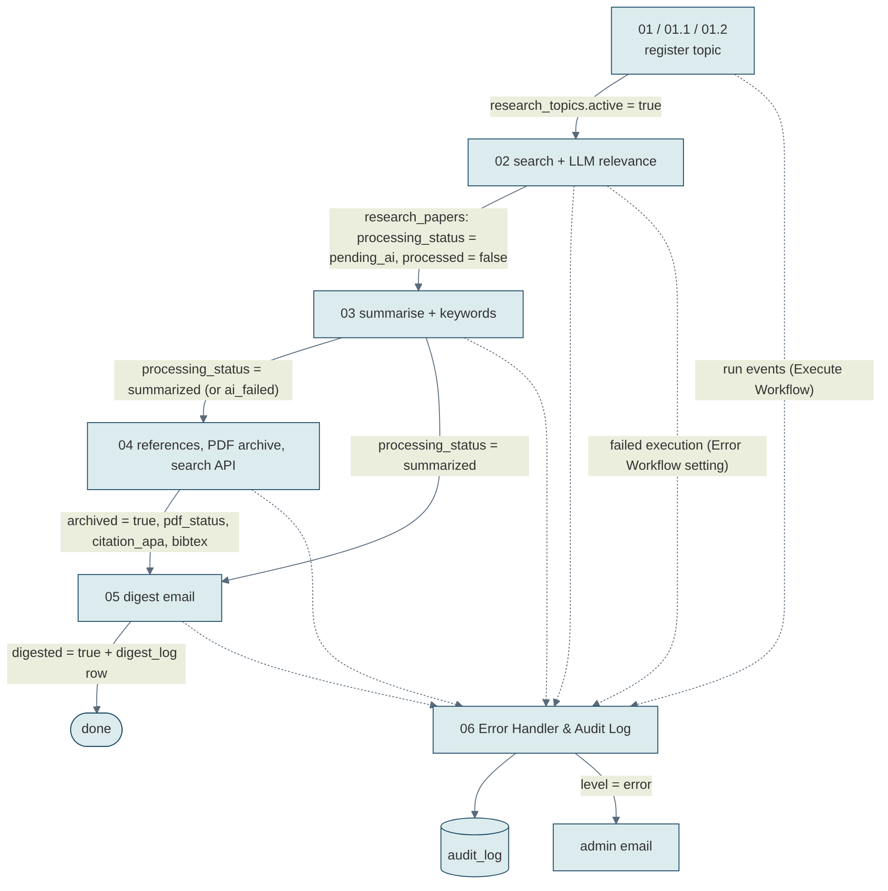

# 2. Workflow Architecture

## 2.1 Overall system architecture

*(Editable source: `architecture.svg`)*

The platform has three layers:

1. **Workflows (n8n Cloud).** Eight workflows: registration (01, 01.1, 01.2), the processing pipeline (02 → 03 → 04 → 05), and observability (06).
2. **Data (n8n Data Tables).** `research_topics`, `research_papers`, `digest_log` and `audit_log`. This is the knowledge base, and the only channel through which the pipeline stages pass work to each other.
3. **External services.** arXiv and Semantic Scholar (literature), OpenAI gpt-5-mini (relevance, summaries, digest overview), Google Drive (PDF and `.bib` archive), Gmail (digests and admin alerts).

## 2.2 Workflow interaction diagram

*(Editable source: `event-flow.mmd`, Mermaid)*

## 2.3 Event flow between workflows

The workflows never call each other directly to pass work along. Each stage reads rows in a given state, does its job, and writes the next state:

| Stage | Field written | Next stage reads |
|---|---|---|
| 01 registers topic | `research_topics.active = true` | 02 |
| 02 stores relevant paper | `processed = false`, `processing_status = pending_ai` | 03 |
| 03 summarises | `processing_status = summarized` (or `ai_failed`), `processed = true` | 04, 05 |
| 04 archives | `archived = true`, `pdf_status`, `citation_apa`, `bibtex`, `drive_file_url` | 05, Search API |
| 05 emails digest | `digested = true` + row in `digest_log` | (done) |

Two channels go to workflow **06**:

- **Run events.** Every workflow ends with *Build Run Summary* → *Log to Audit Trail* (Execute Workflow, `waitForSubWorkflow = false`).
- **Failures.** 01–05 have *Settings → Error Workflow = 06*. Any unhandled node error starts 06's Error Trigger.

### Daily timeline (scheduled mode, Asia/Kolkata)

| Time | Workflow | What happens |
|---|---|---|
| any time | 01 / 01.1 | Researcher registers a topic |
| 08:00 | 02 | Search + relevance filter for all active topics |
| every hour | 03 | Summarise up to 20 new papers |
| 09:00 | 05 | Digests for topics due today (daily; weekly on Mondays; monthly on the 1st) |
| 10:00 | 04 | Citations, PDF archive, `.bib` library |
| on request | 04 search API | `GET /webhook/research/papers/search` |

## 2.4 Key design decisions

| Decision | Why |
|---|---|
| **State machine in Data Tables** instead of chaining workflows | Each stage can be scheduled, re-run and debugged on its own. A failure in one stage never corrupts another. A paper's status shows exactly where it is in the pipeline. |
| **Two literature sources merged into one record** | arXiv covers preprints and gives PDF links; Semantic Scholar adds DOIs and published papers. Merging fills gaps without creating duplicates. |
| **LLM relevance gate before storage** | Keyword search returns many papers that only mention the term. Storing only papers scored ≥ 0.70 keeps the knowledge base and the digests focused. |
| **Skip already-stored papers before calling the LLM** | Cost control: a paper is scored once per topic. |
| **LLM output treated as untrusted** | Every response is parsed, range-checked and validated, and failures go down an explicit branch (`ai_failed`, score 0, plain-list fallback). |
| **Deterministic citations** | APA and BibTeX are built in code from metadata, not by the LLM, so references can't be hallucinated. |
| **Central error workflow + fire-and-forget logging** | One place to see every run and every failure, and logging can never break the calling pipeline. |
| **Secrets only in n8n credentials** | No API key appears in any JSON, so the export is safe to publish. |

## 2.5 Sub-workflow contract (06)

- **Input:** `workflow` (string), `event` (string), `level` (`info` | `warning` | `error`), `message` (string), `details` (object or string), `execution_id`.
- **Output guaranteed:** one `audit_log` row per event. Invalid levels are coerced to `info`.
- **Failure:** 06 never throws back to the caller.
